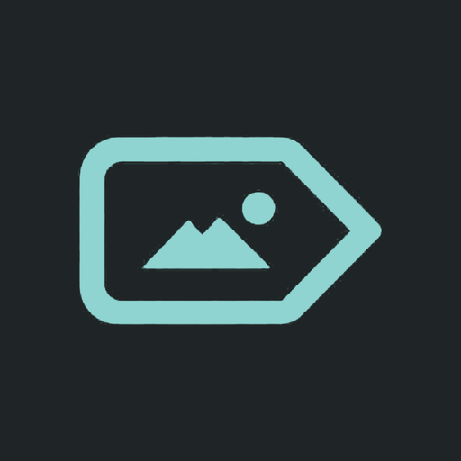

# FileViewer

一个只做两件事的轻量 Android 应用：**播放视频**、**查看图片**。

本项目基于 [anilbeesetti/nextplayer](https://github.com/anilbeesetti/nextplayer) 二次开发，图片查看功能参考 [FossifyOrg/Gallery](https://github.com/FossifyOrg/Gallery)。

它没有媒体库、播放列表、历史记录等主界面，也不在桌面放置启动图标：所有功能都由其他应用通过「打开方式 / 分享」调用。

## 使用方式

其他应用（文件管理器、相册、浏览器、聊天工具等）以 `VIEW` 意图打开视频时即可调用播放器，支持：

- 本地文件与 `content://` 视频
- `http/https`、`rtsp/rtp/rtmp` 等流媒体地址
- `smb`、`ftp`、`sftp`、`webdav` 网络存储地址

以 `image/*` 的 `VIEW` / `SEND` / `SEND_MULTIPLE` 意图打开时，由图片查看界面承载。

## 图片查看

- 双指缩放（1x～8x）、拖动平移、双击放大或复位
- 多张图片一起分享时左右滑动切换，单张时自动隐藏切换
- 点击画面显示 / 隐藏顶部栏与底部操作栏
- 顶部栏：**详情**（左上角）、文件名、当前序号、**设置入口**（右上角）
- 底部操作栏：
  - **分享**当前图片
  - **旋转** 90°
  - **幻灯片**自动轮播（多图时出现，3 秒一张）
  - **删除**：交由系统弹出确认框（Android 11+ 走 MediaStore 删除请求，其他情况直接删除文档），删除后自动切到下一张，删完自动关闭
- 详情面板：名称、分辨率、文件大小、路径、序号
- 支持常见静态格式（JPEG、PNG、WebP、BMP、HEIC/HEIF、AVIF）以及**动图播放**：GIF、动态 WebP、动态 HEIC/AVIF（Android 9+ 使用系统 ImageDecoder，低版本由内置 GIF 解码器兜底）

## 播放器

- 完全免费、开源，无广告
- h264 / hevc 软件解码
- 音轨 / 字幕轨选择，外挂字幕与字幕延迟
- 左侧上下滑动调节亮度，右侧上下滑动调节音量
- 左右滑动快进 / 快退，长按上下滑动实时调速（0.25x～8x）
- 缩放手势、画中画、后台播放
- 设置以全屏浮层在播放器内打开，不打断播放

### 本分支的定制

- **只保留播放器与图片查看**：主页、媒体库、播放列表、网络存储管理、回收站等界面均已删除
- **播放结束停留最后一帧**，并在画面中央显示悬浮「重播」按钮
- **默认不自动播放下一个**，默认竖屏播放（仍可手动旋转）
- **音量与亮度手势优化**：音量连续调节并做去抖，亮度以系统真实亮度为起点

## 设置

设置页按「播放」「音频与字幕」「更多」分组，包含播放器外观、手势、音轨与字幕、用户数据与关于等选项。设置页同时可从播放器右上角与图片查看器顶部栏打开。

## 支持的格式

- **视频**：H.263、H.264 AVC、H.265 HEVC、MPEG-4 SP、VP8、VP9、AV1（实际支持情况取决于设备）
- **音频**：Vorbis、Opus、FLAC、ALAC、PCM/WAVE、MP1/MP2/MP3、AMR、AAC、AC-3、E-AC-3、DTS、DTS-HD、TrueHD（由 ExoPlayer FFmpeg 扩展提供）
- **字幕**：SRT、SSA、ASS、TTML、VTT、DVB（SSA/ASS 样式支持有限）

## 构建

环境要求：JDK 17+、Android SDK（`ANDROID_HOME` 指向 SDK 目录）。

```bash
# 构建所有 debug 变体
./gradlew assembleDebug

# 构建可安装的发布包（使用 debug 签名，便于本地安装体验）
./gradlew :app:assembleRelease-with-debug-signing

# 运行本地单元测试
./gradlew test

# 检查 Kotlin 代码风格
./gradlew ktlintCheck
```

`release-with-debug-signing` 变体在 `app/build/outputs/apk/release-with-debug-signing/` 下产出通用包与按 ABI 拆分的安装包（arm64-v8a、armeabi-v7a、x86、x86_64）。

## 项目结构

- `app/`：应用入口（依赖注入、崩溃处理、文件共享），不包含任何页面
- `core/`：可复用基础层（`common`、`data`、`domain`、`media`、`model`、`ui`、`datastore`、`database`）
- `feature/player`：播放器界面、手势、亮度与音量控制、图片查看、播放服务
- `feature/settings`：设置页与关于页，作为播放器与图片查看器内的全屏浮层复用

## 参与贡献

开发前请先阅读 [AGENTS.md](AGENTS.md)，提交前确保 `assembleDebug`、`test`、`ktlintCheck` 均通过。

## 致谢

### 开源项目

- [Next Player](https://github.com/anilbeesetti/nextplayer)
- [Fossify Gallery](https://github.com/FossifyOrg/Gallery)
- [Findroid](https://github.com/jarnedemeulemeester/findroid)
- [Just (Video) Player](https://github.com/moneytoo/Player)
- [LibreTube](https://github.com/libre-tube/LibreTube)
- [ReadYou](https://github.com/Ashinch/ReadYou)
- [Seal](https://github.com/JunkFood02/Seal)

### 特别感谢

[](https://hosted.weblate.org/engage/next-player/)

感谢 **Weblate** 为项目提供免费的翻译托管服务。

## 许可证

本项目基于 GNU 通用公共许可证 v3.0 发布，详见 [LICENSE](LICENSE) 文件。
